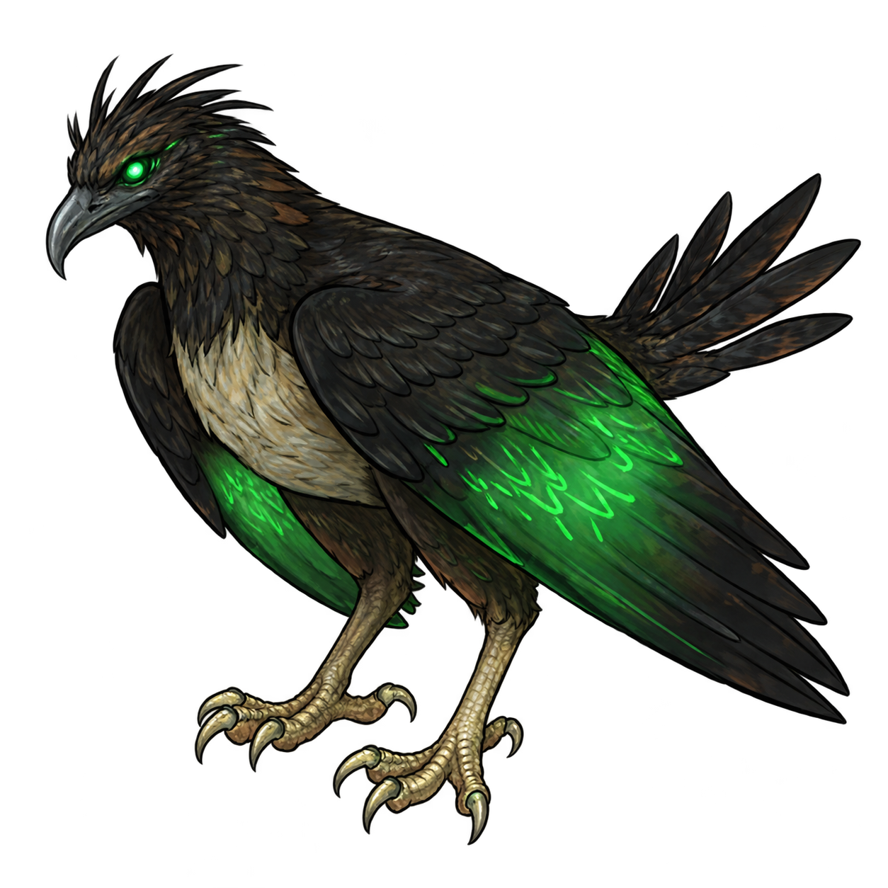

# Summoner · 环世界召唤师

救出契约兽，培养不同分工的伙伴，在战斗、伤病与上场容量之间安排阵容。

**当前版本：0.3.0-dev · RimWorld 1.6 / 1.7 · 依赖 Harmony · 大型版开发中**

[游玩逻辑](docs/GAMEPLAY.md) · [实现进度](docs/STATUS.md) · [开发计划](docs/ROADMAP.md) · [一起开发](CONTRIBUTING.md)

## 德鲁伊三兽

| 灵狼 · 机动近战 | 灵熊 · 正面承伤 | 灵鹰 · 远程支援 |
|:---:|:---:|:---:|
|  |  |  |
| 近战追击与机动 | 承受正面压力 | 发射 20 格风刃 |

以上为当前素材预览，非实机截图。灵狼已有四向素材；熊、鹰暂用透明单视角图，四向与风格统一仍在计划中。原稿及来源记录见 [ArtSource](ArtSource) 和[素材说明](Mod/Textures/ASSET_NOTES.md)。

## 现在能玩到哪一步

已经接入一段可操作的入门流程：


- 从异种商队或轨道异种商人购买觉醒种子，安排殖民者吸收。
- 打开附近的灵兽牢笼，让觉醒者前往缔约；狼、熊、鹰逐步加入德鲁伊编队。
- 在主人“契约编队”面板中呼唤、召回或切换主兽。
- 灵兽可以征召、移动和基础攻击；保留食物、睡眠与医疗需求，接入原版动物搬运训练。

**初始 1 个契约位、1 点上场容量；每槽 1 主兽 + 最多 3 备用兽。** 同槽备用兽通过替换主兽上场。首版以三兽轮换为主，后续通过更多契约位和容量扩展多兽同场。

**升级三选一、突破、锁血、沉睡治疗与复活尚未实现。** 当前救援是地图内的简版牢笼事件，还没有完整远征、守卫与财富分档任务。专属主动技能、工作成长和威胁点补丁也在后续范围内。

## 后续怎么开发

先把德鲁伊的成长与生存循环做完整，再扩展其他血脉。阶段按完成条件推进，暂不承诺发布日期。

| 顺序 | 开发重点 | 完成时应能验证什么 |
|---|---|---|
| 已完成首轮 | 数据底座、双版本构建、德鲁伊三兽与契约入门 | 从觉醒到救援、契约、轮换、基础攻击，再完整存读档 |
| 下一步：规则收口 | 奖励次数、经验收入、熟练度、容量与槽位解锁 | 统一每阶 39 次升级与 40 次奖励预算，明确和平/战斗成长速度与解锁条件 |
| 成长系统 | 战斗/工作经验、三选一队列、技能/工作培养、主人反哺 | 连续升级、保存未决选项、读档不重抽，主人与兽的成长都能结算 |
| 突破与生存 | 灵质、阶位突破、锁血退回、沉睡、死亡与复活、主人失效规则 | 从一阶培养到二阶；退回、真死、复活与存读档相互一致 |
| 德鲁伊 MVP 完整化 | 完整救援、专属技能、清洁/医疗、UI、威胁点与平衡 | 完整游玩循环，轮换与不同培养路线都有使用价值 |
| 后续扩展 | Phase 2 亡灵/元素/机械/虫族；Phase 3 混沌影子与终局玩法 | 在已有循环上扩展，不提前铺开尚未验证的系统 |

美术可以并行推进：先补齐熊、鹰四向素材，统一三兽风格，再制作技能图标、牢笼与风刃效果、编队界面素材。每项资源保留原稿与来源，接入后分别检查 1.6、1.7 的显示效果。

完整分阶段任务与待定规则见[开发路线](docs/ROADMAP.md)。设计以[系统设计需求 v0.10.2](docs/References/召唤师流派系统设计需求v0.10.md)为依据；需求版本不代表功能已经实现。

## 想一起开发

先阅读[协作说明](CONTRIBUTING.md)，配置各自的游戏目录，再从功能分支提交 Pull Request。一次认领一个任务，涉及同一文件时先协调。

| 方向 | 可以先认领的工作 |
|---|---|
| 玩法与代码 | 成长规则讨论、经验结算、奖励队列、工作与专属技能 |
| 美术 | 熊/鹰四向、三兽统一风格、图标与技能效果 |
| 测试与文档 | 两版回归、UI 逐按钮试玩、数值记录、存读档与问题复现 |

角色没有固定分配，按兴趣和任务边界认领即可。玩法规则改变时同步更新 `docs/GAMEPLAY.md`；实现范围变化时同步 `docs/STATUS.md`。

## 兼容与验证

- 维护 RimWorld **1.6 与 1.7** 两个构建目标，分别使用 net48、net10.0 与对应 Harmony。
- 当前不强制 VPE、VEF、Royalty 或 Biotech；未来血脉需要的 DLC 按阶段单独接入。
- 最近一次记录的真实游戏验收为 **2026-10-14**：两版均通过觉醒、开笼、契约、移动、轮换、风刃命中和两轮存读档，测试期间零捕获错误。
- 尚未验证跨版本迁档、CE、多人和完整成长/死亡循环；UI 视觉与鼠标操作仍需继续验收。

[双版本兼容说明](docs/COMPATIBILITY.md) · [三兽与契约验证结果](docs/tasks/03_DRUID_CONTRACT_RESULT.md) · [验证记录](docs/Evidence/druid-contract)

## 构建与试玩

仓库保存源码、定义和素材，**克隆后需要自行构建**；游戏文件、Harmony DLL、SDK、测试副本及 `Dist/` 编译包不进入 Git。

准备 .NET 10 SDK、对应版本的游戏与 Harmony，将 `.build.local.example.json` 复制为 `.build.local.json`，填写自己的游戏目录。完整游戏测试工具需要 PowerShell 7.4+。

```powershell
./Tools/Build.ps1 -GameVersion Both
./Tools/Verify-Package.ps1
./Tools/Package.ps1
```

游戏或 Workshop 路径与默认值不同时，用脚本参数覆盖，详见[首次配置](CONTRIBUTING.md#第一次配置)。本机配置、构建缓存和输出按版本隔离。

<details>
<summary>展开构建与回归命令</summary>

```powershell
# 两版分别指定游戏目录
./Tools/Build.ps1 -GameRoot16 'X:/RimWorld-1.6' -GameRoot17 'X:/RimWorld-1.7'
# 只构建一个版本
./Tools/Build.ps1 -GameVersion 1.7 -GameRoot 'X:/RimWorld-1.7'
# 诊断与运行中游戏保护
./Tools/Test-DataFoundation.ps1 -GameVersion 1.7 -Mode regression
./Tools/Test-DataFoundation.ps1 -GameVersion 1.7 -Mode live-guard
# 原始数据底座存读回归
./Tools/Test-GameArchive.ps1 -GameVersion 1.6 -TestMode Archive
./Tools/Test-GameArchive.ps1 -GameVersion 1.7 -TestMode Archive
# 觉醒、救援、契约、移动、轮换、战斗与两轮存读
./Tools/Test-GameArchive.ps1 -GameVersion 1.6 -TestMode Gameplay
./Tools/Test-GameArchive.ps1 -GameVersion 1.7 -TestMode Gameplay
```

测试默认在 `C:/SummonerTests` 创建独立完整副本与存档，隔离临时缓存。不要在系统临时目录运行，也不要使用指向原游戏资源的目录链接。隔离宿主的 `full` 模式缺少完整游戏初始化，不能代替真实游戏验收。

</details>

打包输出为 `Dist/RimModSummoner-v0.3.0-dev-1.6-1.7.zip`。根目录放共用资源，`LoadFolders.xml` 只加载当前版本对应的程序集；包内不附带游戏、Harmony 或测试模块。

## 项目导航

| 位置 | 内容 |
|---|---|
| [docs/GAMEPLAY.md](docs/GAMEPLAY.md) | 玩家循环、成长与待定规则 |
| [docs/STATUS.md](docs/STATUS.md) | 已实现内容与验证边界 |
| [docs/ROADMAP.md](docs/ROADMAP.md) | 阶段计划、任务与完成条件 |
| [CONTRIBUTING.md](CONTRIBUTING.md) | 环境配置与协作方式 |
| [Source](Source) / [Tests](Tests) / [Tools](Tools) | 代码、验证与构建工具 |
| [Mod](Mod) / [ArtSource](ArtSource) | 游戏定义、运行素材与美术源稿 |
| [docs/References](docs/References) | 权威需求及历史参考 |

当前只维护大型版。旧单狼玩法已移除，历史仍保留在 Git 中；大型版历史交付包仅作资源与需求参考，不直接参与编译。
