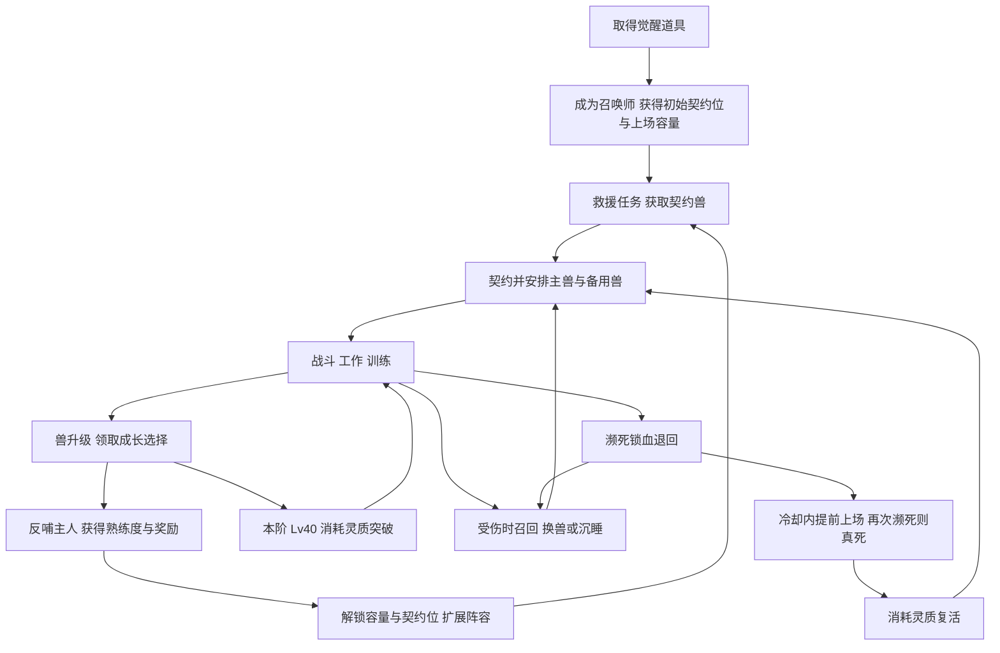

# 召唤师 Mod 游玩逻辑与成长体系

更新日期：2026-10-14。

2026-10-28 追加生物来源决定：后续优先联动奇幻生物包，沿用来源物种及原生素材，独立三兽美术暂停。下文狼/熊/鹰是当前 0.3 原型与定位示例，后续物种通过白名单逐个映射到血脉和角色，不强制换名或统一套用三兽数值。当前还没有已验收的外部联动，见[接入方案](INTEGRATIONS.md)。

核心体验是：**救出并收集契约兽，通过战斗和工作培养它们，用成长选择决定分工，在伤病、上场容量和灵质资源之间安排阵容。** 召唤师扩展管理能力，兽获得等级与阶位，两条成长线通过升级反哺连接。

后续开发统一采用[系统设计需求 v0.10.2](References/召唤师流派系统设计需求v0.10.md)。本文只描述大型版。当前 0.3.0-dev 已接入觉醒、地图内简版救援、德鲁伊三兽、契约、呼唤/召回/轮换、征召移动和基础攻击；升级、突破、锁血、沉睡治疗与复活仍是后续设计。第七节尚未收口的规则不得视为已实现。

## 当前可以操作的流程

1. 从异种商队或轨道异种商人购买觉醒种子，安排殖民者吸收；获得 1 个契约位与 1 点上场容量，重复觉醒不会重复给容量。
2. 稍后在主人附近出现封印灵狼的牢笼。选择牢笼“解救灵兽”，派殖民者实际走过去打开。
3. 选择获救灵兽“缔结契约”，让觉醒者前往完成契约。首兽成为主兽，该槽固定为德鲁伊血脉，兽进入灵境。
4. 选择主人“契约编队”，呼唤主兽；选择场上灵兽可征召、移动、攻击和召回。狼近战机动、熊正面承伤、鹰发射 20 格风刃。
5. 简版救援在有编队名额且没有待救/未契约灵兽时，约每 2 游戏日继续出现，依次引入熊、鹰。后续兽进入备用列表，每槽最多三备用。
6. 编队中切换主兽：旧主兽在场则先召回，再派出新主兽；旧主兽已在灵境则只改变主兽身份，之后手动呼唤。每槽仅一只主兽在场，上场容量另外校验。

地图内牢笼是当前获取入口，尚无远征地图、守卫或财富分档的完整任务。两日节奏与道具价格是开发版初值。通用工作目前只接原版动物搬运训练；清洁、医疗与自定义工作等级未实现。基础健康按身体模板与 healthScale 表达，不把模板缩放当作已标定的单一总 HP；普通属性成长与基础护甲地板尚未接入。

2026-10-14 用户已确认：**先采用每槽一主兽、三兽轮换；后续通过更多契约位和上场容量扩展同场。** 同血脉多槽解锁条件留待熟练度阶段，首版不允许同槽备用兽直接上场。

## 一 完整游玩循环

| 游玩阶段 | 玩家主要行动 | 阶段目标 |
|---|---|---|
| 入门 | 从遗迹、商人、任务等奖励取得觉醒道具，完成首个救援任务 | 获得第一只可培养的兽 |
| 建立分工 | 收集德鲁伊狼、熊、鹰，安排主兽和备用兽 | 根据敌情选择机动、承伤或远程角色 |
| 培养 | 战斗、搬运、清洁、医疗或训练；处理未决奖励 | 形成战斗或工作构筑 |
| 扩张 | 积累召唤师熟练度，取得更多契约位和上场容量 | 从单兽轮换进入多兽协同，具体规则待收口 |
| 突破 | 兽满本阶 40 级，采集灵质并手动突破 | 保留特殊能力，进入下一阶重新培养 |
| 后期 | 四阶满级，完善技能与工作能力 | 当前设计终点；融合等终局机制留待 Phase 3 |

大型版 MVP 仅有德鲁伊：灵狼负责机动近战，灵熊负责承伤，灵鹰负责远程支援。三者均占 1 点上场容量，均需吃饭、睡觉和治疗，关闭心情需求；HP、近战伤害、移速享受 ×1.15 后勤补偿。搬运、清洁为通用工作，德鲁伊另有医疗定位。

六条血脉最终各有战士、肉盾、远程三种定位，共 18 种兽。亡灵、元素、机械、虫族属于 Phase 2；混沌影子属于 Phase 3。MVP 目标是原版可运行，不强制 Royalty、VPE 或 Biotech。

## 二 收集数量与上场数量

大型版需要把「拥有几只」与「同时派出几只」分开理解。

| 概念 | 管什么 | 初始规则 |
|---|---|---|
| 契约位 | 一条固定血脉的编队通道 | 1 个；首次契约后固定血脉 |
| 主兽 | 该契约位当前使用的兽 | 每槽 1 只 |
| 备用兽 | 同槽可轮换的同血脉兽 | 每槽最多 3 只，主兽不计入 |
| 上场容量 | 所有在场兽占用之和 | 初始 1 点 |
| 体量 | 单只兽消耗多少上场容量 | 每个物种固定占 1 或 2 点 |

一个完整契约位最多管理 **1 主 + 3 备 = 4 只兽**。两个契约位最多管理 8 只。拥有 8 只不代表能同时派出 8 只，还要满足上场容量及主兽规则。

第一次契约使空槽固定到该兽的血脉。同血脉新兽可加入有空余名额的备用列表；跨血脉需要另一个空契约位。单槽中收集狼、熊、鹰，可以分别按需求顶替主兽。现已确定每槽仅主兽上场；多兽同场将通过更多契约位与容量解锁，具体阈值留待后续。

主兽切换没有切换冷却，但被选兽自身的沉睡冷却仍然有效。切换必须先让原在场兽离场，再检验新兽的上场容量，不能因操作顺序短暂超额。

进化可能改变物种，使体量由 1 变为 2；此时上场容量需至少支持新体量。体型变异与体量是两回事：升级选「体型」不自动增加占用点数。

## 三 三条相连的成长线

### 兽的经验与阶内等级

每只兽有独立经验，阶位为 1–4，每阶等级为 1–40。

| 经验来源 | 需求给出的初值 | 对游玩的影响 |
|---|---|---|
| 参与击杀敌方单位 | 100 × 敌方战斗力 / 1000 | 与目标强度挂钩；参与资格和多人分配仍需明确 |
| 工作 | 搬运 5、清洁 3、医疗 8、训练 5 / 小时 | 提供和平时期成长；按任务还是按小时计量有歧义 |
| 木桩或训练场 | 3 / 小时 | 提供可控训练来源 |

单次升级所需经验为：`100 × 当前等级 × 1.2^(阶位−1)`。按 Lv1→Lv40 的 39 次升级计算：

| 阶位 | Lv1→Lv2 | Lv39→Lv40 | 本阶满级所需总经验 |
|---|---:|---:|---:|
| 一阶 | 100 | 3900 | 78,000 |
| 二阶 | 120 | 4680 | 93,600 |
| 三阶 | 144 | 5616 | 112,320 |
| 四阶 | 172.8 | 6739.2 | 134,784 |

四阶共计 418,704 经验，未计终局成长；表中高阶小数未取整。这些是原公式的推算值，尚不能据此承诺实际升级速度。经验是否跨阶累计、突破时是否保留溢出值，也需要定义。

### 兽的成长选择

升级把奖励放入「未决奖励」队列，由玩家空闲时打开领取。

| 奖励 | 触发 | 玩家可选内容 | 跨阶处理 |
|---|---|---|---|
| A 类成长 | 每次升级 | 伤害、攻速、HP、移速、护甲等普通属性，或体型、多肢、护盾、再生等特殊变异 | 普通属性突破时重置；特殊变异保留 |
| B 类能力 | 每 4 级 | 技能学习、精进、变异，或工作培养 | 技能与工作等级、记录保留 |

**一次 A 类奖励只能选一项。** 普通属性与特殊变异共用选择次数；选体型就少一次选伤害或 HP 的机会。B 类是按周期额外触发的奖励，不占 A 类预算。

普通属性只在选中时增长，按本阶固定增量增加，达到该属性硬上限后退出选项池。特殊变异永久保留，同类重复收益递减，并有层数上限：体型最多 3，多肢最多 2，护盾或再生等部件最多 2。自带基础护甲另有随等级、阶位自动提高的地板，独立于玩家投资的护甲成长。

目前需求同时写了「Lv1–40」「每次升级一次」和「每阶 40 次 A 类选择」，三者不能直接成立。B 类的技能与工作是否也共用一次选择，尚需明确。不要在实现前假定每阶已有确定奖励总数。

### 召唤师熟练度与反哺

召唤师有独立的熟练度，不消耗兽的经验。

| 来源 | 需求初值 |
|---|---:|
| 契约兽升级 | 50 × 阶位 × 等级 |
| 使用绑定技 | 每次 20 |
| 参与战斗或契约事件 | 100–500 |

800 熟练度解锁第二点上场容量；1500 解锁第二契约位。后续阈值翻倍并附带仪式要求，但第二契约位的 MVP / Phase 2 边界仍需统一。

兽还会直接反哺主人：1 体量兽每升 4 级、2 体量兽每升 2 级，触发召唤师一次三选一，可选主人属性、核心绑定技升级或反哺强度。**熟练度负责容量解锁，反哺负责主人能力选择。** 两者是兽升级同时带来的不同收益。

血脉阶和血脉经验属于 Phase 2；MVP 无需再引入这条成长线。技能学习通过奖励选择与核心技解锁，不引入技能点货币。

## 四 突破怎样改变成长

一阶 Lv40 → 消耗 3 灵质 → 二阶 Lv1；二阶 Lv40 → 5 灵质 → 三阶 Lv1；三阶 Lv40 → 8 灵质 → 四阶 Lv1。突破需要玩家手动确认，四阶不再突破到第五阶。

突破重置普通属性、普通属性投入次数和阶内等级，保留特殊变异、技能与工作成长。因此玩家保留伙伴长期形成的特殊能力，并在新阶重新分配普通属性。

以原始近战伤害 `base=20` 为例，原需求的计算为：

- 每次选伤害的增量：`base × 0.10 × 1.5^(阶位−1)`。
- 本阶普通伤害上限：`base × (3 + 2×阶位)`。
- 突破后的普通伤害起点：`base + 0.35 × (上一阶上限−base)`。
- 最终伤害：普通段先截断到上限，再乘特殊变异等适用倍率；德鲁伊近战最后乘 1.15。

这里的 `base` 始终是原始物种基线 20，不是突破后的起点 48、62 或 76。

| 阶位 | 普通伤害起点 | 每次选伤害增加 | 普通伤害上限 | 达到上限所需伤害选择次数 |
|---|---:|---:|---:|---:|
| 一阶 | 20 | 2 | 100 | 40 |
| 二阶 | 48 | 3 | 140 | 31 |
| 三阶 | 62 | 4.5 | 180 | 27 |
| 四阶 | 76 | 6.75 | 220 | 22 |

若按需求的每阶 40 次预算，一阶投入 37 次伤害、3 次体型，普通伤害为 94，按原算例的体型 ×2.5 得 235，再乘后勤补偿后为 270.25。该值以「40 次预算」和「三层体型确实合计 ×2.5」成立为前提。

体型跨阶保留，若一阶已拿满三层，二阶不能再拿三层；二阶剩余选择应转投其他属性或能力。原需求各阶的「37 伤害 + 3 体型」示例应理解为带三层体型的属性对照，不能直接当作同一只兽每阶重复投入的有效培养记录。

突破继承固定上一阶上限的 35% 差额，**不按上一阶实际投入量继承**。因此不同普通属性投资的兽进入新阶后，会回到相同物种基线；特殊变异、技能和工作差异仍然保留。玩家确认突破前，应能看到突破后的实际属性，判断暂时下降是否可接受。

## 五 召回 休整和死亡的风险

灵魂界负责保存契约兽。统一按玩家动作理解术语：

| 动作 | 方向与用途 | 限制或代价 |
|---|---|---|
| 灵魂呼唤 | 灵魂界 → 场上 | 检查上场容量、主兽资格及该兽冷却 |
| 灵魂召回 | 场上 → 灵魂界 | 主动撤回，不自动施加 3 日沉睡冷却 |
| 主兽切换 | 同槽替换当前主兽 | 无切换冷却；不绕过兽自身沉睡冷却 |
| 沉睡 | 强制进入灵魂界休整 | 仅该兽 3 游戏日不可上场；同槽其他兽可替补 |
| 锁血退回 | 即将倒地或死亡时自动撤回 | 包扎伤口，启动该兽 1 游戏日锁血冷却 |
| 复活 | 真死 → 可继续使用的兽 | 消耗灵质，给主人 2 日枯竭；同兽复活冷却 1 日 |

锁血依据意识、关键部位致命伤、疼痛或失血等即将倒地/死亡条件，使用固定 HP 百分比不能完整表达这套规则。

**锁血退回后可以立即再次上场，但冷却没有消失。** 这时再次濒死会真死。安全选择是换备用兽顶上，或让伤兽沉睡休整；紧急选择是冒险提前派它回场。

原需求的 Active、Retreated、Sleeping、Lockout、Dead 混合了位置、休整方式和锁血冷却。理解时可拆开：兽在场上还是灵魂界，是正常待命还是沉睡，锁血是否可用，是否已死亡。这样可以说明「在场且锁血冷却中」和「界内且锁血冷却中」的差异。

疾病、饥饿和极端温度也会触发退回。灵魂界暂停恶化、不消耗补给，但召回后原问题仍可能存在；若在锁血冷却内再次濒死，仍会真死。需求中的「不会因非战斗原因真死亡」应按这个限制收口，不能解释成完全免疫后勤死亡。

复活的灵质初值为一阶 5、二阶 8、三阶约 13、四阶约 21。灵魂枯竭使主人全局工作效率和冥想/休息效率各下降 20%，持续 2 日。没有灵质时保留死亡记录，等待复活。

灵质既用于突破也用于复活。玩家需要在提前提升阶位与保留应急复活物资之间选择；灵质矿脉是主来源，任务提供少量补充，敌对召唤师掉落留待后续阶段。

## 六 玩家会反复面对的选择

| 决策 | 为什么影响玩法 |
|---|---|
| 当前派狼 熊还是鹰 | 同槽主兽限制让收集形成轮换价值，敌情和工作需求改变选择 |
| 升级投伤害 生存还是工作 | 普通属性与特殊变异共用 A 类预算，构筑存在机会成本 |
| 继续作战还是换备用兽 | 锁血退回提供一次保护，但提前上场会冒真死风险 |
| 普通撤回还是沉睡 | 普通撤回便于调度，沉睡带休整收益和单兽 3 日禁上场 |
| 灵质用于突破还是留给复活 | 两项成长与恢复行为竞争同一物资 |
| 保留现有满级能力还是立即突破 | 突破提高长期上限，同时重置普通段，可能暂时降低战力 |

如果体型对多种属性都提供很强倍率，它可能成为所有构筑的共同必选项，削弱选择价值。若在灵魂界储藏兽就能完全避开袭击战力计入，玩家又可能通过频繁收兽改变袭击强度。这两项都应在 MVP 实测中检查，而不是只核对面板数值。

## 七 实现前需要收口的规则

以下为整理发现与建议，尚未变更原需求或游戏行为。

### 影响核心循环的四项

| 问题 | 原需求中的冲突或缺口 | 建议讨论方向 |
|---|---|---|
| 成长次数 | Lv1→Lv40 为 39 次升级，但算例和验收要求 40 次 A 类选择 | 若保留 40 次预算，可每阶 Lv1 发一次初始 A 奖励，后续 39 次升级各发一次；也可统一改成 39 次并重算数值。明确 B 类和反哺按达到等级还是升级次数触发 |
| 多兽上场 | 原需求每槽 1 主兽与备用兽可呼唤之间存在歧义 | 已确认首版每槽仅 1 主兽在场，狼熊鹰轮换；之后通过多槽与容量扩展同场，解锁阈值待熟练度阶段 |
| 经验速度 | 一阶需要 78,000 XP；目标约 1–2 日/级，但按 8 XP/小时医疗，即使全天持续工作也只有 192 XP/日 | 明确工作计量单位后重新调曲线或收益。按一阶约 40–80 日完成，需要平均约 975–1950 XP/日；不能只写目标速度而保留不匹配的收入 |
| 第二契约位 | §6.1 在 1500 熟练度解锁，§20 又把第二位双魂仪式放到 Phase 2 | 明确 MVP 达阈值是否直接增加契约位，还是只取得资格；同时解释仅德鲁伊时新槽如何使用 |

召唤师解锁速度也与兽升级速度分离。若升级反哺熟练度中的 `level` 指升级后的等级，仅靠第一只一阶兽从 Lv1 升到 Lv6 可累计 1000，从 Lv1 到 Lv8 可累计 1750，分别超过 800 和 1500；战斗、契约和施法收入会进一步提前。等级参数口径未明确，因此这些是带假设的推算。

若每次呼唤/召回都无成本地给予 20 熟练度，40 次可达到 800，75 次可达到 1500。需要定义有效施法、奖励间隔或递减，避免重复调度取代培养成长。

### 影响持续养成的规则

| 问题 | 需要补齐的行为 |
|---|---|
| 四阶满级之后 | §10.3 同时写「Lv40 为终点」和「之后每升一级仍发奖励」。需选择封顶，或另设不增加阶内等级的终局经验循环，并定义阈值、奖励池与反哺是否继续 |
| 真死与复活 | §3.6 真死清空在栏占用，§10 又要求之后可复活。需保留死亡档案，并明确复活时槽满怎么办、原血脉槽是否保留、恢复何种健康与成长状态 |
| 主人死亡或失效 | 大型版未给出召唤师死亡、被俘、离开阵营后主兽、备用兽和灵魂界的完整规则 |
| 同血脉救援兽入队 | §3.3 允许加入备用列表，§15 却只按有无空契约位处理。应先检查同血脉备用名额，再检查可用空槽，最后才提供无契约跟随或放归 |
| 体型倍率 | 三层体型写为 ×2.5，重复变异又按 0.85 递减；尚无单层增幅及叠加公式。需明确作用于哪些属性，并验证没有唯一最优选项 |
| 升级奖励边界 | B 类技能/工作是一份奖励还是各一份；奖励池不足三项、全满、连续升级、未领奖就突破如何处理；已生成奖励需保存，避免读档重抽 |
| 基础技能取得 | 核心技表只说明效果，未说明哪些觉醒即有、哪些契约后有、哪些熟练度解锁、哪些必须在反哺中选取 |
| 灵魂界休整 | 沉睡写有缓慢恢复，普通退回写有暂停恶化；需明确各状态的恢复速率、疾病与失肢是否恢复、备用兽能否继续升级 |
| 其他数值边界 | 攻速用频率还是间隔表达、HP 如何落实到身体部位、经验和灵质如何取整、突破/复活后冷却怎样继承 |

护甲与威胁点属于已定设计方向，兼容效果仍需实际实现和验证。需求里「CE 天然兼容」及「不会重复计威胁点」不能视为已测试结论。德鲁伊三兽面板中的后期 HP 是示意值，不是与「37 伤害 + 3 体型」预算一致的一套完整构筑结果。

## 八 后续整理与实现顺序

1. 先确定奖励总次数、多兽上场方式、MVP 槽位解锁、经验收入四项规则，写成一份可逐条验收的闭环。
2. 用一名召唤师和狼、熊、鹰验证获取、契约、轮换、上场容量、工作、撤回及存读档，不先扩展其他血脉。
3. 接入升级队列、普通属性与特殊变异、B 类能力及主人反哺，验证不同构筑的选择价值。
4. 接入灵质采集、突破、锁血、沉睡与复活，完成从觉醒到二阶的完整游玩流程。
5. 测量实际升级用时、轮换频率、死亡损失、资源收入与袭击强度，再扩展二至四阶和后续血脉。

工程已移除旧版玩法，后续按本大型版循环从头实施。各项游戏行为必须通过新的验收场景验证。

## 依据与文档入口

- [项目说明与构建入口](../README.md)

- [大型版权威需求 v0.10.2](References/召唤师流派系统设计需求v0.10.md)：核心循环 §1；契约与容量 §2–3；成长与经验 §4–6；死亡 §7.3；灵质 §10；核心技与任务 §14–15；阶段规划 §20。
- [开发路线与实施顺序](ROADMAP.md)
- [当前实现状态与验证边界](STATUS.md)
